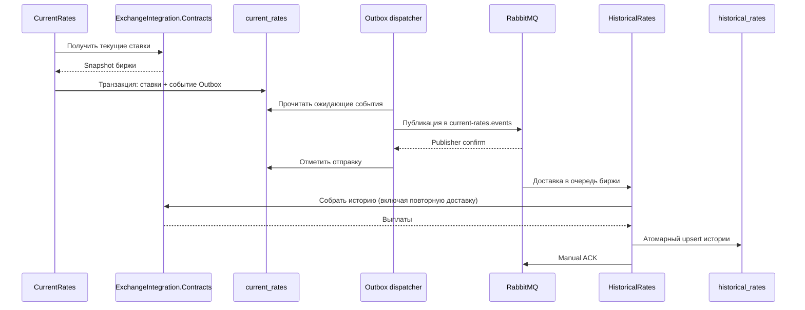
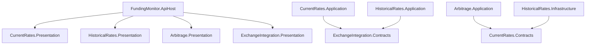
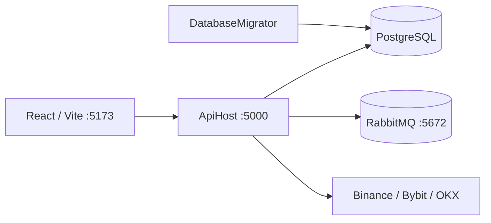

# Сценарии использования FundingMonitor

Пользователь выбирает символы и биржи, просматривает текущие ставки, историю, APR и арбитражные возможности. Backend собирает данные в фоне; frontend отображает результаты расчётов.

| Сценарий | HTTP-маршрут | Модуль |
| --- | --- | --- |
| Текущие ставки | `GET /api/v1/FundingRates` | CurrentRates |
| История | `GET /api/v1/History` | HistoricalRates |
| APR статистика | `GET /api/v1/History/apr-stats` | HistoricalRates |
| Арбитражные возможности | `GET /api/v1/Arbitrage` | Arbitrage |
| Состояние бирж | `GET /api/v1/exchanges/health` | ExchangeIntegration |

## Сбор и доставка изменений

У каждой биржи отдельная очередь и worker pool, по умолчанию 10 consumers с `prefetch=1`. Повтор того же `EventId` снова вызывает API биржи; upsert не создаёт дубли исторических точек. Backend запускается одним экземпляром с одним последовательным Outbox dispatcher. Временная ошибка ведёт к confirmed retry, permanent error и исчерпанные попытки — к confirmed DLQ. Только после подтверждения новой публикации исходное сообщение получает ACK.

## Зависимости модулей

Каждый из четырёх модулей имеет `Contracts`, `Domain`, `Application`, `Infrastructure`, `Presentation`. Межмодульные зависимости идут только через Contracts. HistoricalRates использует публичное событие CurrentRates, не его persistence. Arbitrage получает ставки через контракт, выполняет расчёт в памяти и не имеет БД.

## Локальное развёртывание

Compose запускает PostgreSQL и RabbitMQ. Сначала успешно завершается DatabaseMigrator, затем запускается ApiHost. Host сам не меняет схему БД. Проверка `/health` дополняется HTTP-проверками данных и отдельной проверкой RabbitMQ consumers.

Подробности: [архитектура](index.md), [схема БД](../database-schema.md), [развёртывание](../deployment/docker.md).
