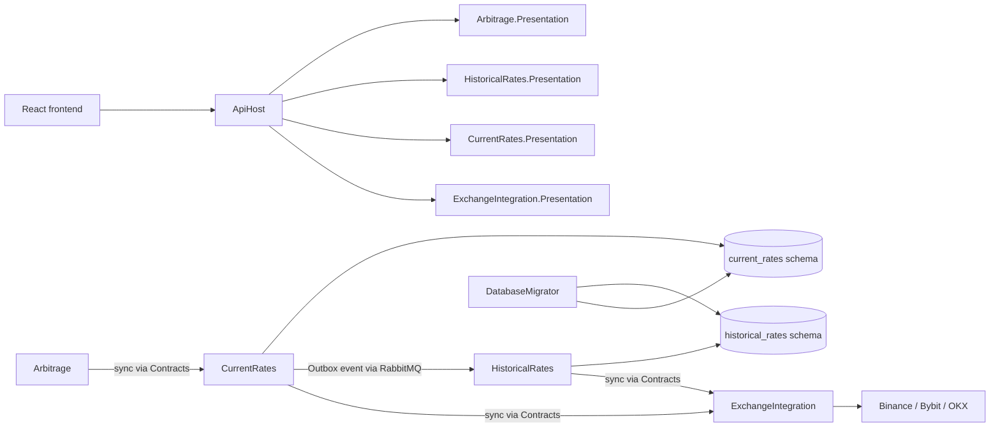
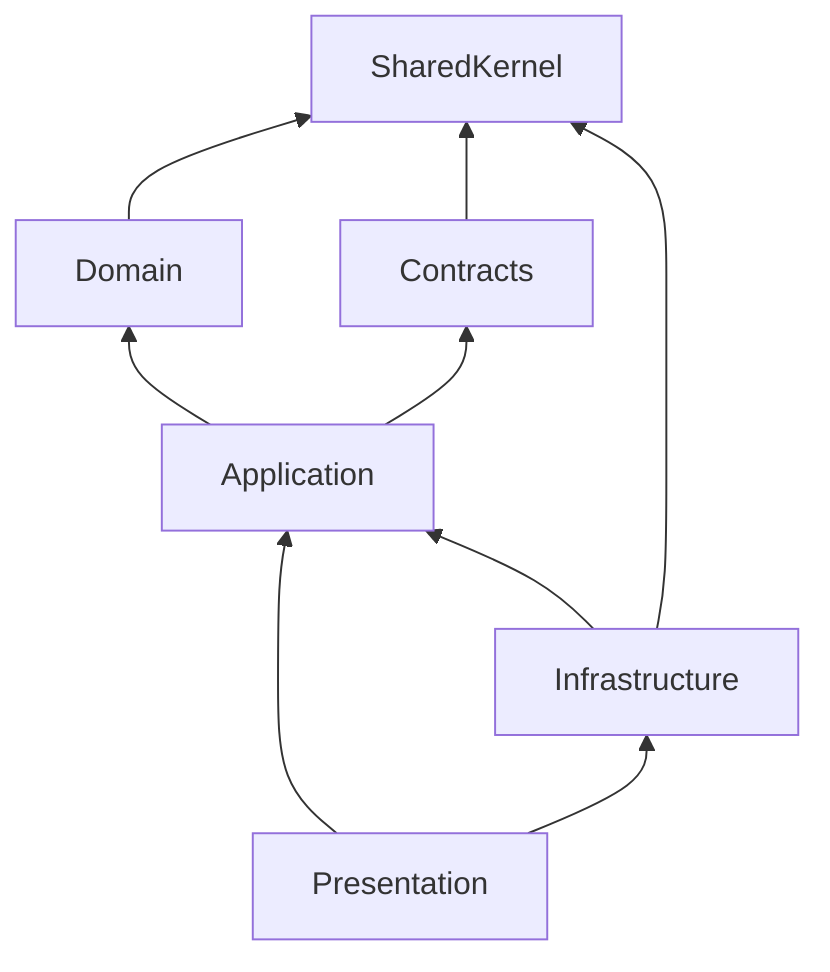

# Архитектура FundingMonitor

FundingMonitor — строгий модульный монолит: один `FundingMonitor.ApiHost` собирает четыре изолированных бизнес-модуля. Каждый модуль разделён на `Contracts`, `Domain`, `Application`, `Infrastructure` и `Presentation`; другой модуль может использовать только его `Contracts`.

## Общая карта

| Модуль | Ответственность | Состояние |
| --- | --- | --- |
| `ExchangeIntegration` | SDK бирж, нормализация, rate limits и health | Без persistence |
| `CurrentRates` | Сбор, актуальность и выдача текущих ставок | schema `current_rates`, Outbox |
| `HistoricalRates` | Исторический сбор, retry/DLQ, история и APR | schema `historical_rates` |
| `Arbitrage` | Расчёт арбитражных возможностей | Только память |

Подробная карта и статус проверки: [модули](modules/index.md). Межмодульные потоки: [сквозные сценарии](scenarios.md).

## Слои модуля

- `Contracts` — публичные DTO, интерфейсы и integration events.
- `Domain` — бизнес-модель и правила без framework dependencies.
- `Application` — сценарии использования и внутренние порты.
- `Infrastructure` — persistence, внешние SDK, messaging и фоновые процессы.
- `Presentation` — HTTP controllers, DTO mapping и регистрация модуля.

`FundingMonitor.SharedKernel` содержит стабильные общие примитивы без бизнес-логики. `FundingMonitor.Messaging` содержит только транспортные RabbitMQ abstractions и envelope. Architecture tests проверяют project references, compiled dependencies, публичные поверхности и изоляцию database schemas.

## Данные и доставка

`CurrentRates` и `HistoricalRates` используют одну PostgreSQL database, но владеют разными schemas и `DbContext`. Cross-schema queries, foreign keys и EF navigation properties запрещены. Миграции применяет отдельный `FundingMonitor.DatabaseMigrator`; `ApiHost` не изменяет schema при запуске.

`CurrentRates` сохраняет ставки и Outbox event в одной транзакции. Один последовательный dispatcher публикует событие в RabbitMQ и отмечает его обработанным после publisher confirm. `HistoricalRates` повторно запрашивает биржу при каждой доставке и атомарно выполняет history upsert по `(Exchange, NormalizedSymbol, FundingTime)` перед manual ACK. Inbox отсутствует. Гарантия — `at-least-once` с идемпотентным сохранением истории; текущая конфигурация поддерживает один экземпляр backend.

## HTTP

| Метод | Маршрут | Модуль |
| --- | --- | --- |
| GET | `/api/v1/FundingRates` | CurrentRates |
| GET | `/api/v1/History` | HistoricalRates |
| GET | `/api/v1/History/apr-stats` | HistoricalRates |
| GET | `/api/v1/Arbitrage` | Arbitrage |
| GET | `/api/v1/exchanges/health` | ExchangeIntegration |
| GET | `/health` | ApiHost health checks |

В Development доступны `/openapi/v1.json` и `/scalar`. Frontend отображает рассчитанные backend значения APR, spread и freshness, а также выполняет клиентские фильтрацию и сортировку.

## Связанные документы

- [Модули](modules/index.md)
- [Сквозные сценарии](scenarios.md)
- [ADR 0012: строгий модульный монолит](../adr/0012-strict-modular-monolith.md)
- [ADR 0013: простой Outbox без Inbox](../adr/0013-simple-outbox-without-inbox.md)
- [Схема БД](../database-schema.md)
- [Развёртывание](../deployment/docker.md)
