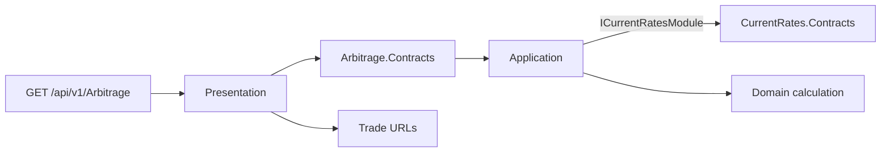
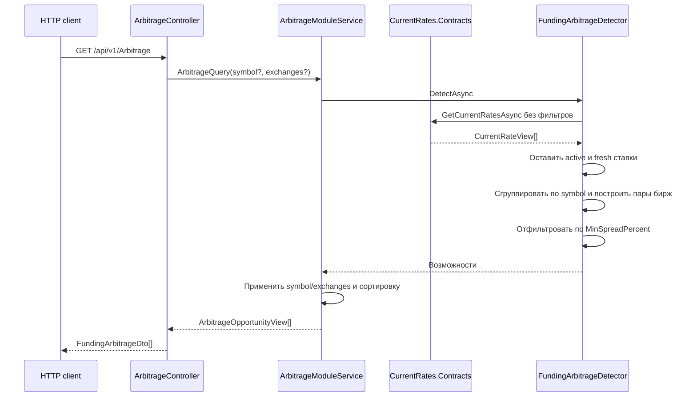
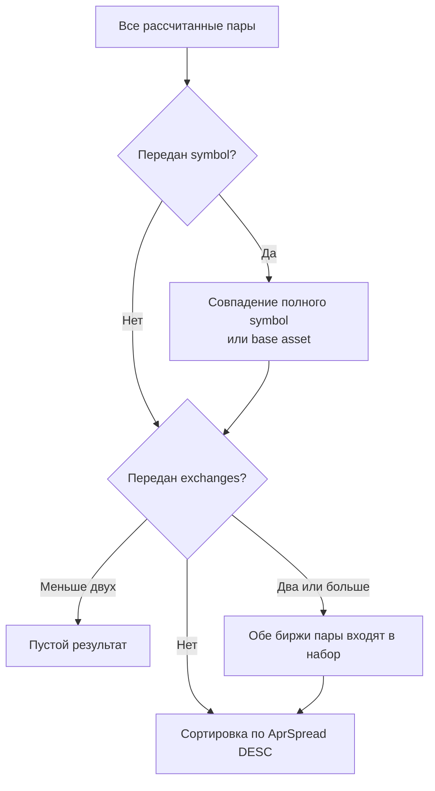

# Arbitrage

`Arbitrage` синхронно рассчитывает возможности между биржами из актуальных ставок `CurrentRates`. Модуль не обращается к API бирж, RabbitMQ или PostgreSQL и не имеет собственного `DbContext`.

## Граница и слои



| Слой | Главное содержимое |
| --- | --- |
| `Contracts` | `IArbitrageModule`, фильтр запроса и готовое представление возможности |
| `Domain` | Формулы spread и выбор short/long биржи |
| `Application` | Получение текущих ставок, проверка свежести, построение пар и фильтрация |
| `Infrastructure` | Только DI и configuration binding; внешней инфраструктуры нет |
| `Presentation` | HTTP endpoint, DTO, mapping и ссылки на торговые страницы бирж |

Единственная межмодульная зависимость — `CurrentRates.Contracts`. `Arbitrage` не читает таблицу `current_rates` напрямую: актуальные ставки предоставляет `ICurrentRatesModule`.

## Расчёт возможностей



Вычисление запускается заново на каждый HTTP-запрос. Singleton `FundingArbitrageService` атомарно заменяет последний массив результатов перед фильтрацией, но это не долговременный кэш: следующий запрос снова читает `CurrentRates` и пересчитывает все пары.

Ставка участвует в расчёте, только если `IsActive=true` и `LastSeenOnUtc` не старше `FundingArbitrage.MaxRateAgeMinutes` — по умолчанию 5 минут. Для каждого символа строятся все пары различных бирж. При трёх биржах это максимум три возможности на символ.

## Формулы и направление позиции

Для пары `ExchangeA`/`ExchangeB` backend рассчитывает:

```text
PriceSpread = PriceA - PriceB
PriceSpreadPercent = abs(PriceA - PriceB) / PriceB * 100
FundingRateSpread = FundingRateA - FundingRateB
AprSpread = abs(AprA - AprB)
PaymentsPerDay = 24 / FundingIntervalHours; fallback = 3
```

`MinSpreadPercent` сравнивается с `AprSpread`, то есть задаёт минимальную разницу APR в процентных пунктах, а не разницу цен. В текущей конфигурации порог равен `10`.

Биржа с большей funding rate назначается `ShortExchange`, с меньшей или равной — `LongExchange`. Модуль показывает расчётную возможность, но не учитывает комиссии, slippage, ликвидность и стоимость открытия/закрытия позиции и не исполняет сделки.

## Фильтрация ответа



Поиск `BTC` и `BTC-USDT` эквивалентен для пары `BTC-USDT`, регистр не учитывается. Фильтр бирж включает возможность только тогда, когда обе её биржи входят в выбранный набор. Некорректное имя биржи возвращает `400 Bad Request` через общий error handling.

Presentation добавляет `ExchangeAUrl` и `ExchangeBUrl`. URL не участвуют в расчёте и формируются отдельно для Binance, Bybit и OKX.

## Основные файлы и проверки

- [Расчёт пар](../../../src/Modules/Arbitrage/FundingMonitor.Arbitrage.Application/FundingArbitrageDetector.cs)
- [Фильтрация результата](../../../src/Modules/Arbitrage/FundingMonitor.Arbitrage.Application/FundingArbitrageService.cs)
- [Domain formulas](../../../src/Modules/Arbitrage/FundingMonitor.Arbitrage.Domain/FundingArbitrageOpportunity.cs)
- [HTTP endpoint](../../../src/Modules/Arbitrage/FundingMonitor.Arbitrage.Presentation/Controllers/ArbitrageController.cs)
- [Unit tests](../../../tests/FundingMonitor.Arbitrage.UnitTests/ArbitrageModuleTests.cs)

См. также [сквозные сценарии](../scenarios.md), [CurrentRates](current-rates.md) и [ADR 0012](../../adr/0012-strict-modular-monolith.md).
