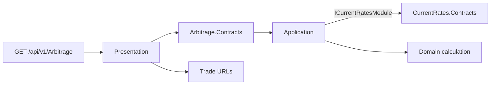
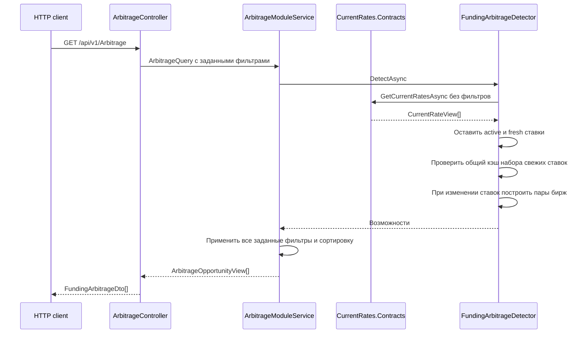

# Arbitrage

`Arbitrage` синхронно рассчитывает возможности между биржами из актуальных ставок `CurrentRates`. Модуль не обращается к API бирж, RabbitMQ или PostgreSQL и не имеет собственного `DbContext`.

## Граница и слои



| Слой | Главное содержимое |
| --- | --- |
| `Contracts` | `IArbitrageModule`, фильтр запроса и готовое представление возможности |
| `Domain` | Формулы spread и выбор short/long биржи |
| `Application` | Получение текущих ставок, проверка свежести, построение пар и фильтрация |
| `Infrastructure` | Только DI и configuration binding; внешней инфраструктуры нет |
| `Presentation` | HTTP endpoint, DTO, mapping и ссылки на торговые страницы бирж |

Единственная межмодульная зависимость — `CurrentRates.Contracts`. `Arbitrage` не читает таблицу `current_rates` напрямую: актуальные ставки предоставляет `ICurrentRatesModule`.

## Расчёт возможностей



Каждый HTTP-запрос читает текущие ставки и проверяет их активность и свежесть. `ArbitrageSnapshotCache`, общий для запросов одного процесса, хранит только последний упорядоченный набор свежих ставок и построенные пары. Если значения ставок не изменились, запрос переиспользует готовые пары; при изменении или исключении просроченных ставок пары строятся заново. Конкурирующие запросы с одинаковым набором выполняют построение один раз. Переданные пользователем фильтры и сортировка применяются отдельно к общему результату; произвольные наборы фильтров не кэшируются.

Это сокращает повторное построение пар, но сохраняет чтение текущих ставок из БД на запрос. Кэш локален для одного процесса API. Контракт ответа остаётся полным списком: клиентская пагинация по монетам не снижает объём передачи данных.

Ставка участвует в расчёте, только если `IsActive=true` и `LastSeenOnUtc` не старше `FundingArbitrage.MaxRateAgeMinutes` — по умолчанию 5 минут. Для каждого символа строятся все пары различных бирж. При трёх биржах это максимум три возможности на символ.

## Формулы и направление позиции

Для пары `ExchangeA`/`ExchangeB` backend рассчитывает:

```text
PriceSpread = PriceA - PriceB
PriceSpreadPercent = (MarkPriceShort - MarkPriceLong) / ((MarkPriceShort + MarkPriceLong) / 2) * 100
FundingRateSpread = FundingRateA - FundingRateB
AprSpread = abs(AprA - AprB)
PaymentsPerDay = 24 / FundingIntervalHours; fallback = 3
```

Биржа с большим APR назначается Short, с меньшим — Long. При равных APR порядок определяется идентификаторами бирж. При неизвестном интервале APR пары, стороны и направленный ценовой спред имеют значение `null`. Для ценового спреда нужны обе положительные цены маркировки.

## Фильтрация ответа

Все переданные критерии действуют одновременно. `minAprPercent` задаёт нижнюю границу APR пары, а `maxAdversePriceSpreadPercent` ограничивает неблагоприятный ценовой спред. Обе границы включительны. Нулевой ценовой лимит допускает благоприятный и нулевой спред. Если соответствующий показатель неизвестен, при заданном пороге пара исключается. `sameFundingIntervalOnly=true` требует двух равных положительных интервалов `FundingIntervalHours`. Без параметров возвращаются все рассчитанные пары. Ответ отсортирован по убыванию APR, неизвестные значения идут в конце.

Поиск `BTC` и `BTC-USDT` эквивалентен для пары `BTC-USDT`, регистр не учитывается. Фильтр бирж включает возможность только тогда, когда обе её биржи входят в выбранный набор. Некорректное имя биржи возвращает `400 Bad Request` через общий error handling.

Presentation добавляет `ExchangeAUrl` и `ExchangeBUrl`. URL не участвуют в расчёте и формируются отдельно для Binance, Bybit и OKX.

## Основные файлы и проверки

- [Расчёт пар](../../../src/Modules/Arbitrage/FundingMonitor.Arbitrage.Application/FundingArbitrageDetector.cs)
- [Кэш последнего набора ставок](../../../src/Modules/Arbitrage/FundingMonitor.Arbitrage.Application/ArbitrageSnapshotCache.cs)
- [Фильтрация результата](../../../src/Modules/Arbitrage/FundingMonitor.Arbitrage.Application/FundingArbitrageService.cs)
- [Domain formulas](../../../src/Modules/Arbitrage/FundingMonitor.Arbitrage.Domain/FundingArbitrageOpportunity.cs)
- [HTTP endpoint](../../../src/Modules/Arbitrage/FundingMonitor.Arbitrage.Presentation/Controllers/ArbitrageController.cs)
- [Unit tests](../../../tests/FundingMonitor.Arbitrage.UnitTests/ArbitrageModuleTests.cs)

См. также [сквозные сценарии](../scenarios.md), [CurrentRates](current-rates.md) и [ADR 0012](../../adr/0012-strict-modular-monolith.md).
