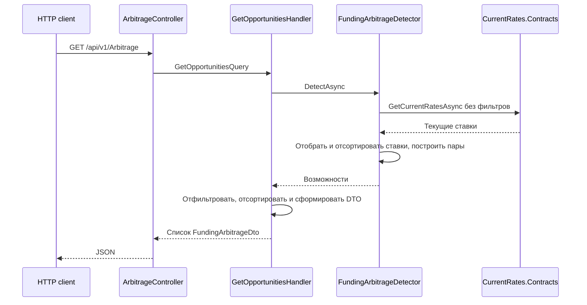

# Arbitrage

`Arbitrage` рассчитывает возможности между биржами из актуальных ставок `CurrentRates`. `ApiHost` подключает один проект `FundingMonitor.Arbitrage` через `AddArbitrageModule`. Ставки предоставляет `ICurrentRatesModule` из `CurrentRates.Contracts`.

## GetOpportunities

В каталоге `GetOpportunities/` находятся HTTP-вход, параметры, фильтры и преобразование в ответ. В `Calculation/` находятся проверка актуальности ставок и расчёт пар.



На каждый запрос детектор читает текущие ставки. Для расчёта ставка должна быть активной и наблюдаться в пределах `FundingArbitrage.MaxRateAgeMinutes` (по умолчанию 5 минут). Также нужны положительные bid и ask с `bid <= ask`, известная ставка funding, положительный интервал и время следующего платежа в будущем.

На каждый запрос детектор сортирует подходящие ставки по символу и бирже и строит все пары разных бирж. При трёх биржах получается до трёх пар на символ. Порядок бирж в паре определяется сортировкой ставок. Фильтры применяются к заново рассчитанным парам. Клиентская пагинация использует полученный полный список.

## Формулы

Биржа с большим APR становится Short, с меньшим — Long. При равенстве APR сторона Short определяется порядком идентификаторов бирж.

```text
PriceSpread = BidShort - AskLong
PriceSpreadPercent = 100 * PriceSpread / ((BidShort + AskLong) / 2)
FundingRateSpread = FundingRateA - FundingRateB
AprSpread = abs(AprA - AprB)
PaymentsPerDay = 24 / FundingIntervalHours
```

## Фильтры и ответ

Все переданные фильтры действуют одновременно. Поиск по символу игнорирует регистр и принимает базовый актив (`BTC`) или полный символ (`BTC-USDT`). Фильтр бирж оставляет пару, если обе биржи входят в заданный набор. Некорректное имя биржи даёт `400 Bad Request`.

`minAprPercent` задаёт включительную нижнюю границу APR пары. `maxAdversePriceSpreadPercent` ограничивает неблагоприятный спред, поэтому пара проходит, если `PriceSpreadPercent >= -maxAdversePriceSpreadPercent`. Нулевой лимит пропускает нулевой и положительный спред. `sameFundingIntervalOnly=true` оставляет пары с одинаковыми положительными интервалами. Ответ отсортирован по убыванию APR пары. DTO включает торговые ссылки Binance, Bybit и OKX.

## Где смотреть код

- [HTTP-вход и валидация](../../../src/Modules/Arbitrage/GetOpportunities/ArbitrageController.cs)
- [Фильтрация и формирование ответа](../../../src/Modules/Arbitrage/GetOpportunities/GetOpportunitiesHandler.cs)
- [Расчёт пар](../../../src/Modules/Arbitrage/Calculation/FundingArbitrageDetector.cs)
- [Формулы](../../../src/Modules/Arbitrage/Calculation/FundingArbitrageOpportunity.cs)
- [Модульные проверки](../../../tests/FundingMonitor.Arbitrage.UnitTests/ArbitrageModuleTests.cs)
- [HTTP и OpenAPI](../../../tests/FundingMonitor.ApiHost.IntegrationTests/Endpoints/Arbitrage/GetArbitrageTests.cs)

См. также [сквозные сценарии](../scenarios.md), [CurrentRates](current-rates.md) и [ADR 0012](../../adr/0012-strict-modular-monolith.md).
