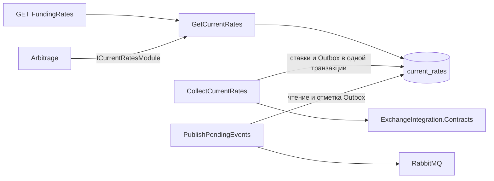
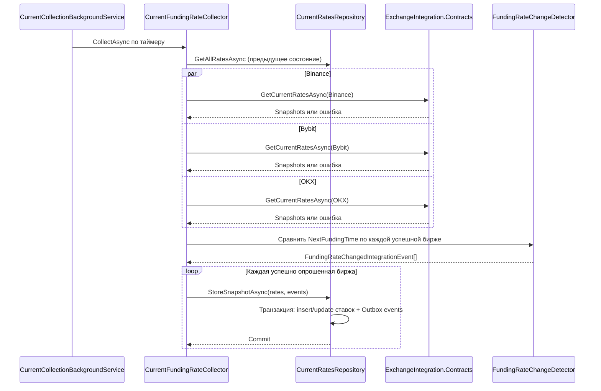
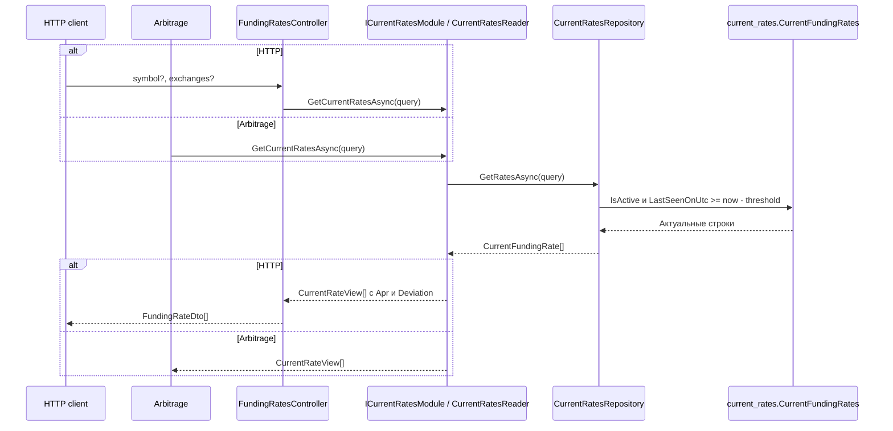
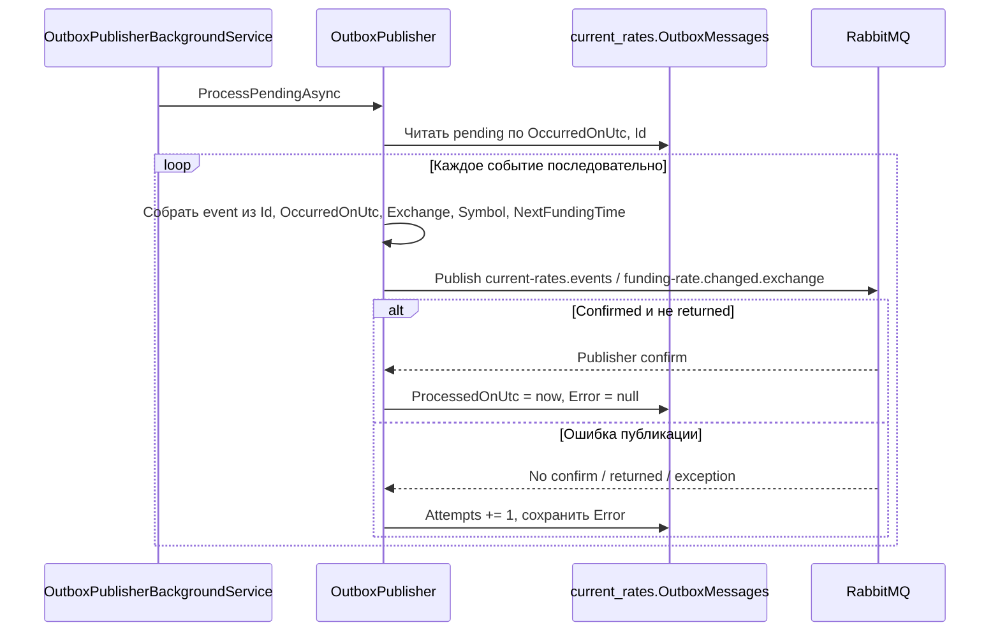

# CurrentRates

`CurrentRates` периодически собирает текущие funding rates, хранит последнее состояние каждой пары, исключает устаревшие ставки из выдачи и публикует задания на исторический сбор. Модуль владеет schema `current_rates`, но не обращается к schema истории.

## Сценарии и границы

| Каталог | Главное содержимое |
| --- | --- |
| `GetCurrentRates` | Контроллер, DTO и чтение ставок через `ICurrentRatesModule` |
| `CollectCurrentRates` | Таймер, сборщик, настройки и определение событий |
| `PublishPendingEvents` | Издатель Outbox, фоновый цикл и настройки |
| `Persistence` | Общие DbContext, репозиторий, EF-сущности и миграции |

Три среза находятся в одном проекте `FundingMonitor.CurrentRates`. `ApiHost` подключает модуль целиком, а `DatabaseMigrator` регистрирует только БД. Отдельный `CurrentRates.Contracts` содержит интерфейс чтения для `Arbitrage` и тип события для `HistoricalRates`. Сборщик получает котировки через `ExchangeIntegration.Contracts`.

## Периодический сбор CollectCurrentRates

Сборщик сравнивает полученные ставки с предыдущими и передаёт ставки и события в `StoreSnapshotAsync` для записи в одной транзакции. После сохранения он пишет итог цикла в лог: число ставок, событий, успешных и неуспешных опросов и длительность сбора.

`CurrentRateSnapshot` описывает наблюдение по одному инструменту. `StoreSnapshotAsync` сохраняет успешный набор ставок конкретной биржи. В `ApiHost/appsettings.json` цикл настроен на 5 секунд. Биржи опрашиваются параллельно. При ошибке одной биржи результаты успешно опрошенных бирж сохраняются отдельно.

Новую задачу истории создаёт новая пара либо изменение `NextFundingTime` у существующей пары. Изменение только `FundingRate` или `FundingIntervalHours` событие не создаёт. Ставки и созданные events коммитятся одной PostgreSQL-транзакцией на биржу: при ошибке записи не сохраняется ни то, ни другое.

При успешном наборе отсутствующая пара деактивируется, только если её `LastSeenOnUtc` старше порога актуальности. Повторное появление пары обновляет timestamp и активирует её. Последние значения остаются в БД.

## Чтение текущих ставок

В срезе `GetCurrentRates` контроллер разбирает HTTP-параметры и формирует DTO. Контроллер и `Arbitrage` используют `ICurrentRatesModule`, который реализует `CurrentRatesReader`. Чтение ставок и транзакционная запись снимка используют общий `ICurrentRatesRepository`.

Порог `DeactivateMissingAfterMinutes` по умолчанию равен 5 минутам. Проверка свежести выполняется **при каждом чтении**, даже если биржа давно не дала успешный набор и поле `IsActive` в БД ещё равно `true`. Поэтому просроченная ставка не участвует и в расчёте `Arbitrage`.

`CurrentRatesQuery.Symbol` фильтрует по `BaseAsset` (например, `BTC`), а не по полной паре `BTC-USDT`. `Apr` и `Deviation` вычисляет доменная модель на backend; HTTP DTO берёт готовый `Apr`, не рассчитывая его на frontend.

## Публикация Outbox

Хранимую запись `OutboxMessage` используют сборщик при записи ставок и издатель при отправке.

По умолчанию Outbox опрашивается каждые 2 секунды пакетами до 100 событий. Неотправленная строка остаётся pending и будет выбрана снова. После confirm, но до отметки `ProcessedOnUtc`, возможна повторная публикация. Это `at-least-once`, не `exactly-once`. Текущий dispatcher не использует lease или распределённый захват строк и рассчитан на один экземпляр backend. Дальнейшая доставка и идемпотентное сохранение истории описаны в [сквозном сценарии](../scenarios.md).

## Данные и гарантии

`current_rates."CurrentFundingRates"` уникальна по `(NormalizedSymbol, Exchange)`. `current_rates."OutboxMessages"` содержит `Id`, `OccurredOnUtc`, снимок события в `Exchange`, `Symbol`, `NextFundingTime`, а также `ProcessedOnUtc`, `Attempts` и `Error`. JSON payload не хранится: publisher собирает `FundingRateChangedIntegrationEvent` непосредственно из типизированных колонок. Между двумя schemas нет foreign keys или EF navigation properties. Миграции применяет отдельный `DatabaseMigrator`.

## Основные файлы и проверки

- [Таймер сбора](../../../src/Modules/CurrentRates/CollectCurrentRates/CurrentCollectionBackgroundService.cs), [сборщик](../../../src/Modules/CurrentRates/CollectCurrentRates/CurrentFundingRateCollector.cs) и [определение событий](../../../src/Modules/CurrentRates/CollectCurrentRates/FundingRateChangeDetector.cs)
- [Доменные расчёты](../../../src/Modules/CurrentRates/CurrentFundingRate.cs)
- [Repository и транзакция](../../../src/Modules/CurrentRates/Persistence/CurrentRatesRepository.cs)
- [Цикл публикации](../../../src/Modules/CurrentRates/PublishPendingEvents/OutboxPublisherBackgroundService.cs) и [обработка ожидающих событий](../../../src/Modules/CurrentRates/PublishPendingEvents/OutboxPublisher.cs)
- [HTTP-сценарий чтения](../../../src/Modules/CurrentRates/GetCurrentRates/FundingRatesController.cs) и [реализация межмодульного контракта](../../../src/Modules/CurrentRates/GetCurrentRates/CurrentRatesReader.cs)
- [Unit tests](../../../tests/FundingMonitor.CurrentRates.UnitTests/FundingRateChangeDetectorTests.cs) и [integration tests](../../../tests/FundingMonitor.CurrentRates.IntegrationTests/Outbox/CurrentRatesOutboxTests.cs)

См. также [схему БД](../../database-schema.md) и [ADR 0013](../../adr/0013-simple-outbox-without-inbox.md).
