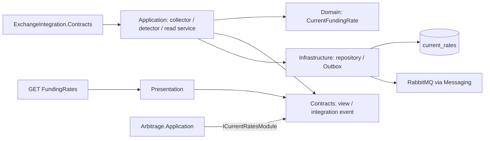
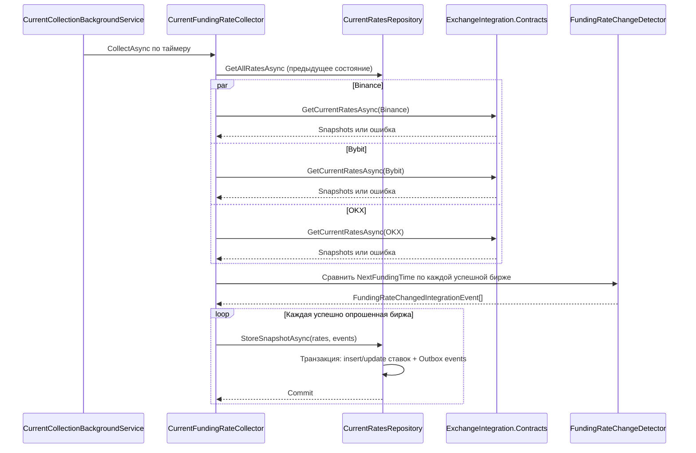
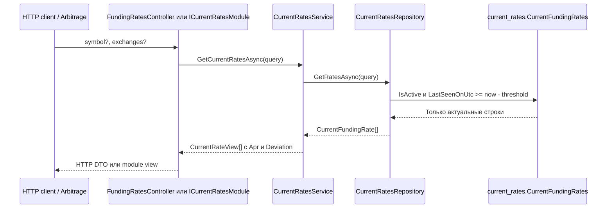
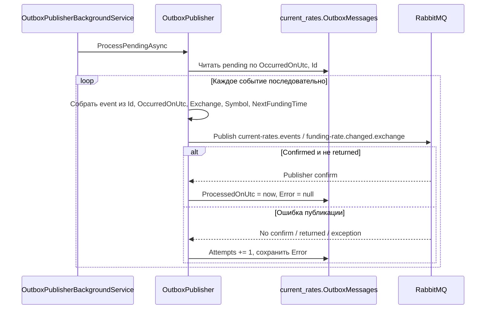

# CurrentRates

`CurrentRates` периодически собирает текущие funding rates, хранит последнее состояние каждой пары, исключает устаревшие ставки из выдачи и публикует задания на исторический сбор. Модуль владеет schema `current_rates`, но не обращается к schema истории.

## Граница и слои

| Слой | Главное содержимое |
| --- | --- |
| `Contracts` | `ICurrentRatesModule`, `CurrentRatesQuery`, `CurrentRateView`, `FundingRateChangedIntegrationEvent` |
| `Domain` | `CurrentFundingRate`, включая вычисление `Apr` и `Deviation` |
| `Application` | Таймер и collector, detector изменений, сценарий чтения, repository ports |
| `Infrastructure` | `CurrentRatesDbContext`, repository, Outbox publisher и его фоновый цикл |
| `Presentation` | `FundingRatesController` и mapping в HTTP DTO |

`CurrentRates.Application` использует только `ExchangeIntegration.Contracts` для получения market data. `Arbitrage` читает ставки только через `CurrentRates.Contracts`. Событие для `HistoricalRates` также принадлежит `CurrentRates.Contracts`, но доставляется асинхронно через Outbox и RabbitMQ.

## Периодический сбор

`CurrentRateSnapshot` — наблюдение одной пары, полученное от `ExchangeIntegration`; `StoreSnapshotAsync` сохраняет уже весь успешный набор ставок конкретной биржи. По умолчанию цикл запускается каждые 10 секунд. Биржи опрашиваются параллельно, результаты сохраняются отдельно; ошибка одной биржи не отменяет данные успешных бирж.

Новую задачу истории создаёт новая пара либо изменение `NextFundingTime` у существующей пары. Изменение только `FundingRate` или `FundingIntervalHours` событие не создаёт. Ставки и созданные events коммитятся одной PostgreSQL-транзакцией на биржу: при ошибке записи не сохраняется ни то, ни другое.

При успешном наборе отсутствующая пара деактивируется, только если её `LastSeenOnUtc` старше порога актуальности. Повторное появление пары обновляет timestamp и активирует её. Последние значения остаются в БД.

## Чтение текущих ставок

Порог `DeactivateMissingAfterMinutes` по умолчанию равен 5 минутам. Проверка свежести выполняется **при каждом чтении**, даже если биржа давно не дала успешный набор и поле `IsActive` в БД ещё равно `true`. Поэтому просроченная ставка не участвует и в расчёте `Arbitrage`.

`CurrentRatesQuery.Symbol` фильтрует по `BaseAsset` (например, `BTC`), а не по полной паре `BTC-USDT`. `Apr` и `Deviation` вычисляет доменная модель на backend; HTTP DTO берёт готовый `Apr`, не рассчитывая его на frontend.

## Публикация Outbox

По умолчанию Outbox опрашивается каждые 2 секунды пакетами до 100 событий. Неотправленная строка остаётся pending и будет выбрана снова. После confirm, но до отметки `ProcessedOnUtc`, возможна повторная публикация. Это `at-least-once`, не `exactly-once`. Текущий dispatcher не использует lease или распределённый захват строк и рассчитан на один экземпляр backend. Дальнейшая доставка и идемпотентное сохранение истории описаны в [сквозном сценарии](../scenarios.md).

## Данные и гарантии

`current_rates."CurrentFundingRates"` уникальна по `(NormalizedSymbol, Exchange)`. `current_rates."OutboxMessages"` содержит `Id`, `OccurredOnUtc`, снимок события в `Exchange`, `Symbol`, `NextFundingTime`, а также `ProcessedOnUtc`, `Attempts` и `Error`. JSON payload не хранится: publisher собирает `FundingRateChangedIntegrationEvent` непосредственно из типизированных колонок. Между двумя schemas нет foreign keys или EF navigation properties. Миграции применяет отдельный `DatabaseMigrator`.

## Основные файлы и проверки

- [Collector](../../../src/Modules/CurrentRates/FundingMonitor.CurrentRates.Application/Collection/CurrentFundingRateCollector.cs) и [detector](../../../src/Modules/CurrentRates/FundingMonitor.CurrentRates.Application/Collection/FundingRateChangeDetector.cs)
- [Доменные расчёты](../../../src/Modules/CurrentRates/FundingMonitor.CurrentRates.Domain/CurrentFundingRate.cs)
- [Repository и транзакция](../../../src/Modules/CurrentRates/FundingMonitor.CurrentRates.Infrastructure/Persistence/CurrentRatesRepository.cs)
- [Outbox publisher](../../../src/Modules/CurrentRates/FundingMonitor.CurrentRates.Infrastructure/Outbox/OutboxPublisher.cs)
- [HTTP controller](../../../src/Modules/CurrentRates/FundingMonitor.CurrentRates.Presentation/Controllers/FundingRatesController.cs)
- [Unit tests](../../../tests/FundingMonitor.CurrentRates.UnitTests/FundingRateChangeDetectorTests.cs) и [integration tests](../../../tests/FundingMonitor.CurrentRates.IntegrationTests/Outbox/CurrentRatesOutboxTests.cs)

См. также [схему БД](../../database-schema.md) и [ADR 0013](../../adr/0013-simple-outbox-without-inbox.md).
