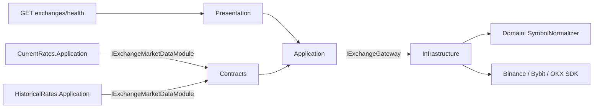
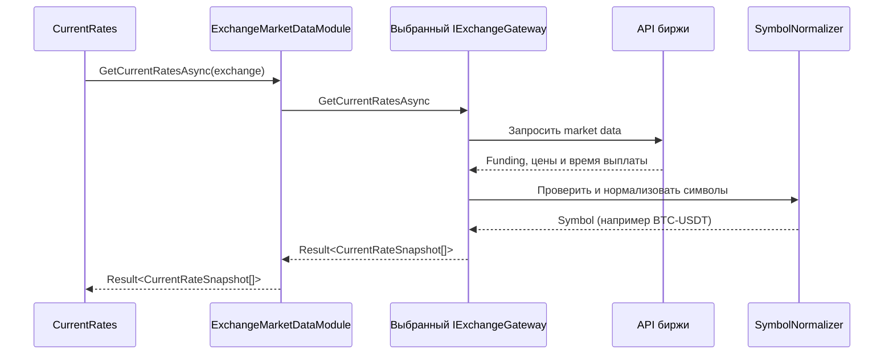
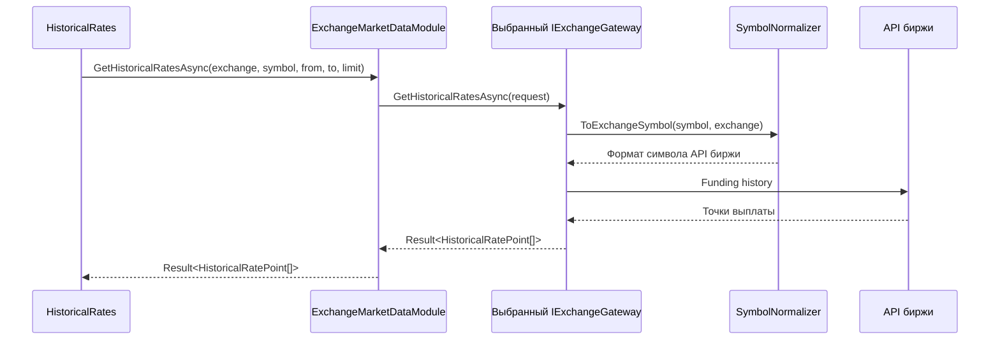
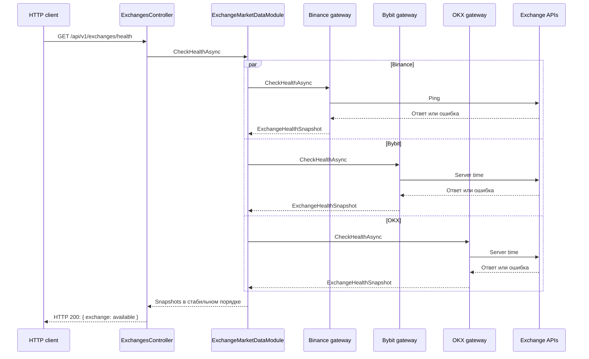

# ExchangeIntegration

`ExchangeIntegration` скрывает различия API Binance, Bybit и OKX. Модуль возвращает нормализованные текущие и исторические ставки и проверяет доступность бирж. Он не сохраняет данные, не рассчитывает APR и не управляет RabbitMQ.

## Граница и слои

| Слой | Главное содержимое |
| --- | --- |
| `Contracts` | `IExchangeMarketDataModule`, `CurrentRateSnapshot`, `HistoricalRatesRequest`, `HistoricalRatePoint`, `ExchangeHealthSnapshot` |
| `Domain` | `SymbolNormalizer`: `BTCUSDT` и `BTC-USDT-SWAP` приводятся к `BTC-USDT`, обратное преобразование используется для истории |
| `Application` | `ExchangeMarketDataModule` выбирает gateway по `ExchangeId`; `IExchangeGateway` задаёт внутренний порт |
| `Infrastructure` | Три gateway, конфигурация SDK, классификация ошибок и метрики запросов |
| `Presentation` | `ExchangesController` публикует только `GET /api/v1/exchanges/health` |

Другие модули ссылаются лишь на `ExchangeIntegration.Contracts`. Gateway и exchange SDK не выходят за границу модуля. Неподдерживаемый `ExchangeId` возвращает `Exchange.NotSupported` (`Validation`), а не вызывает произвольный gateway.

## Текущие ставки

Binance объединяет mark prices и funding intervals; пары без корректного интервала исключаются. Bybit берёт данные из linear tickers. OKX соединяет список swap-инструментов, mark/index prices и funding rates; недоступная ставка отдельного инструмента пропускается. Эти различия не меняют публичный `CurrentRateSnapshot`. Ставки собирает `CurrentRates`, поэтому persistence и определение актуальности находятся там, а не здесь.

## Исторические ставки

`HistoricalRatesRequest` содержит биржу, символ, диапазон времени и лимит. OKX ограничивает один запрос максимумом 100 точек. Модуль приводит время выплат к UTC и добавляет время наблюдения; сохранение, retry и DLQ принадлежат `HistoricalRates`.

## Health бирж

Binance использует ping, Bybit и OKX — server time. Контракт содержит `Available`, `Degraded`, `Unavailable` и `ErrorCode`, но нынешние gateways возвращают `Available` или `Unavailable`; HTTP endpoint преобразует статус в `bool` и не отдаёт `ErrorCode`. Это отдельная проверка бирж, не эквивалентная инфраструктурному `/health`.

## Ошибки и гарантии

`BaseExchangeGateway` переводит большинство сбоев в `Result.Failure` с кодами `Exchange.Timeout`, `Exchange.RateLimited`, `Exchange.GeoRestricted`, `Exchange.Authentication`, `Exchange.InvalidRequest`, `Exchange.AccessDenied`, `Exchange.InvalidResponse`, `Exchange.Network` или `Exchange.UpstreamUnavailable`. Запрошенная вызывающей стороной отмена (`CancellationToken`) пробрасывается как `OperationCanceledException`. Gateway регистрирует длительность и ошибки запросов в метриках. В SDK включён собственный rate limiter; orchestration модуля не содержит самостоятельного retry — решение о повторе исторической задачи принимает `HistoricalRates`.

Health checks выполняются параллельно для всех зарегистрированных gateways и сортируются по имени биржи. Для текущих и исторических ставок выбирается только gateway запрошенной биржи.

## Основные файлы и проверки

- [Публичный контракт](../../../src/Modules/ExchangeIntegration/FundingMonitor.ExchangeIntegration.Contracts/IExchangeMarketDataModule.cs)
- [Маршрутизация запросов](../../../src/Modules/ExchangeIntegration/FundingMonitor.ExchangeIntegration.Application/ExchangeMarketDataModule.cs)
- [Gateway и классификация ошибок](../../../src/Modules/ExchangeIntegration/FundingMonitor.ExchangeIntegration.Infrastructure/Gateways/BaseExchangeGateway.cs)
- [Нормализация символов](../../../src/Modules/ExchangeIntegration/FundingMonitor.ExchangeIntegration.Domain/SymbolNormalizer.cs)
- [HTTP health](../../../src/Modules/ExchangeIntegration/FundingMonitor.ExchangeIntegration.Presentation/Controllers/ExchangesController.cs)
- [Unit tests](../../../tests/FundingMonitor.ExchangeIntegration.UnitTests/ExchangeMarketDataModuleTests.cs) и [gateway integration tests](../../../tests/FundingMonitor.ExchangeIntegration.IntegrationTests/Gateways/GatewayAssertions.cs)

Потоки с участием других модулей показаны в [сквозных сценариях](../scenarios.md).
