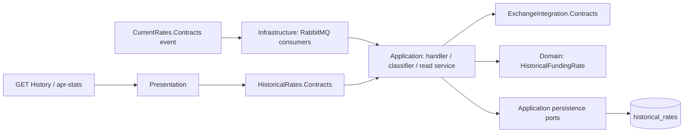
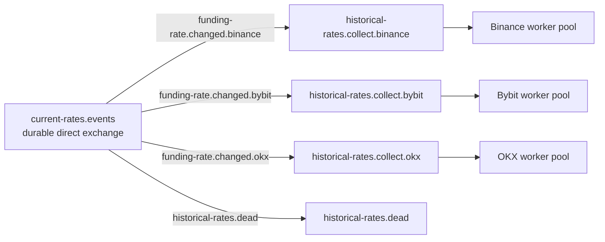
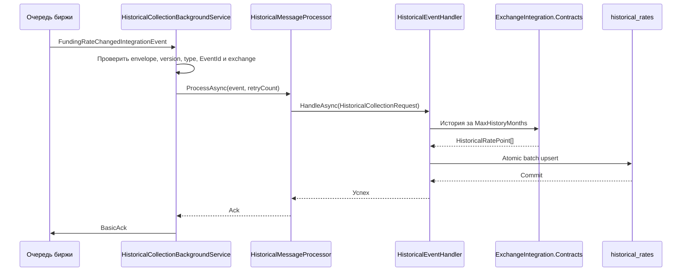
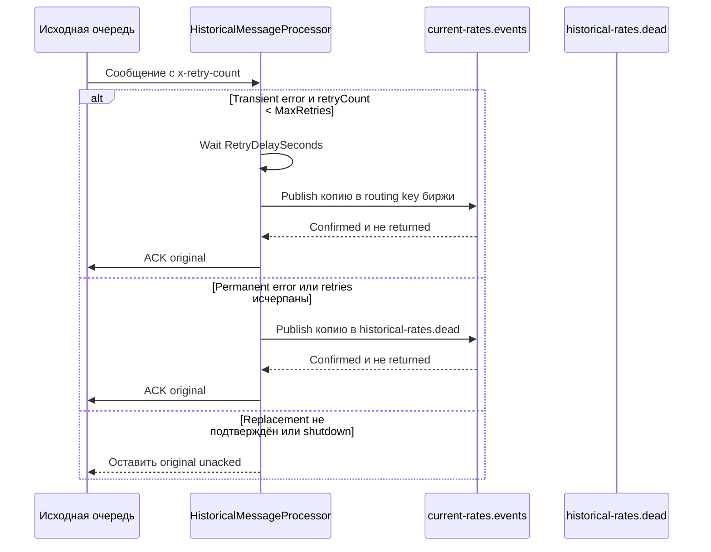
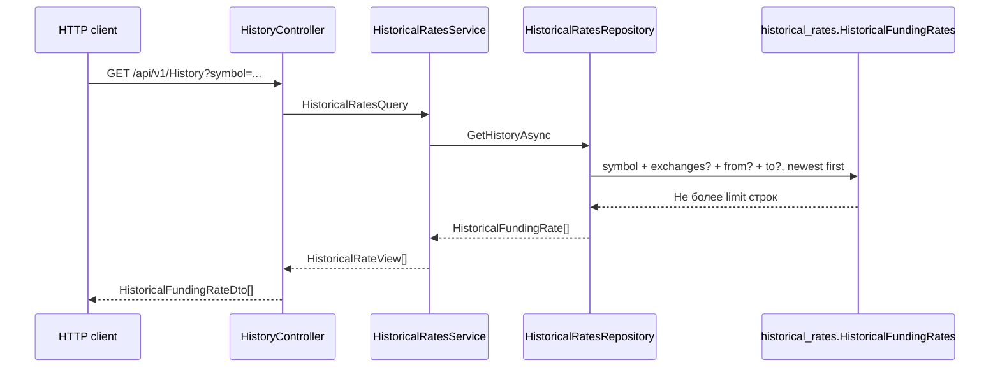
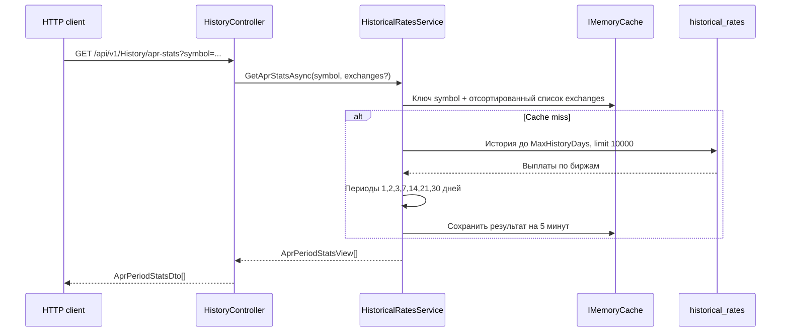

# HistoricalRates

`HistoricalRates` получает задания из RabbitMQ, запрашивает историю funding rates через `ExchangeIntegration`, сохраняет её идемпотентным upsert и предоставляет HTTP API истории и APR statistics. Модуль владеет schema `historical_rates` и не читает таблицы `CurrentRates`.

## Граница и слои



| Слой | Главное содержимое |
| --- | --- |
| `Contracts` | `IHistoricalRatesModule`, history query/view и `AprPeriodStatsView` |
| `Domain` | `HistoricalFundingRate` — одна выплата конкретной биржи и пары |
| `Application` | Сбор истории, классификация сбоев, чтение истории и расчёт APR |
| `Infrastructure` | RabbitMQ topology и workers, retry/DLQ, PostgreSQL repository и health check |
| `Presentation` | `HistoryController` и mapping HTTP DTO |

`HistoricalRates.Application` обращается к биржам только через `ExchangeIntegration.Contracts`. Ссылка на `CurrentRates.Contracts` ограничена Infrastructure: consumer десериализует публичный `FundingRateChangedIntegrationEvent` и преобразует его во внутренний `HistoricalCollectionRequest`.

## Topology и workers



Все очереди — durable classic queues. По умолчанию на каждую биржу создаётся 10 workers; значение можно переопределить через `HistoricalDataCollectionOptions.ExchangeConcurrency`. Каждый worker имеет собственный channel, `prefetch=1` и manual ACK. Поэтому один worker одновременно держит не более одного unacked сообщения, а блокировка Binance не занимает workers Bybit и OKX.

Topology создаётся при старте до запуска consumers. `/health` пассивно проверяет exchange и четыре очереди с timeout 5 секунд; он не проверяет bindings, количество consumers или API бирж.

## Успешная обработка



`NextFundingTime` в событии служит триггером на стороне `CurrentRates`, но `HistoricalRates` не восстанавливает состояние на этот момент. Handler запрашивает актуальную историю от `now - MaxHistoryMonths` до `now`; по умолчанию это один месяц и до 1000 точек за запрос.

Inbox отсутствует. Повторная доставка того же `EventId` снова вызывает API биржи. Batch upsert по `(Exchange, NormalizedSymbol, FundingTime)` атомарно вставляет новые точки и обновляет `FundingRate`/`CollectedOnUtc` существующих. Пустой успешный ответ не выполняет SQL и также допускает ACK.

## Retry, DLQ и malformed messages



По умолчанию разрешено 3 retries с задержкой 30 секунд. Timeout, HTTP 408/429/5xx, rate limit и прочие availability failures повторяются. Ошибки validation/not found/conflict, authentication и geographic restriction сразу направляются в DLQ. Некорректный JSON или envelope публикуется в DLQ как `MalformedHistoricalMessage` с исходным body в Base64. Исходное сообщение получает ACK только после confirmed-публикации replacement; иначе channel закрывается, и broker возвращает unacked delivery.

Worker пересоздаёт channel после shutdown и после `AsyncEventingBasicConsumer.UnregisteredAsync`. Второй сигнал важен при `basic.cancel`: удаление очереди может отменить consumer, не закрывая channel. После неожиданного disconnect worker ждёт 5 секунд перед новой попыткой.

## Чтение истории



`symbol` обязателен. HTTP limit по умолчанию равен 1000 и ограничивается сверху 1000. Результат сортируется от новых выплат к старым.

## APR statistics



Расчёт выполняется на backend отдельно для каждой биржи. Для периода `days` берутся выплаты последних доступных календарных дат, после чего:

```text
TotalFundingRatePercent = Sum(FundingRate) × 100
Apr = TotalFundingRatePercent × 365 / days
AvgFundingRatePercent = TotalFundingRatePercent / PaymentsCount
StdDev = population standard deviation FundingRate × 100
```

Если доступно меньше календарных дней, знаменатель APR всё равно равен запрошенному `days`; это закреплённая legacy formula. Историческая запись не содержит funding interval, поэтому расчёт не использует `FundingIntervalHours`. Кэш живёт в памяти одного процесса и по умолчанию действует 5 минут.

## Основные файлы и проверки

- [RabbitMQ workers](../../../src/Modules/HistoricalRates/FundingMonitor.HistoricalRates.Infrastructure/Messaging/HistoricalCollectionBackgroundService.cs)
- [Message processor](../../../src/Modules/HistoricalRates/FundingMonitor.HistoricalRates.Infrastructure/Messaging/HistoricalMessageProcessor.cs)
- [Сбор истории](../../../src/Modules/HistoricalRates/FundingMonitor.HistoricalRates.Application/HistoricalEventHandler.cs)
- [Failure classifier](../../../src/Modules/HistoricalRates/FundingMonitor.HistoricalRates.Application/HistoricalCollectionFailureClassifier.cs)
- [Repository и upsert](../../../src/Modules/HistoricalRates/FundingMonitor.HistoricalRates.Infrastructure/Persistence/HistoricalRatesRepository.cs)
- [Чтение и APR](../../../src/Modules/HistoricalRates/FundingMonitor.HistoricalRates.Application/HistoricalRatesService.cs)
- [Unit tests](../../../tests/FundingMonitor.HistoricalRates.UnitTests/HistoricalMessageProcessorTests.cs) и [integration tests](../../../tests/FundingMonitor.HistoricalRates.IntegrationTests/Persistence/HistoricalPersistenceTests.cs)

См. также [сквозные сценарии](../scenarios.md), [схему БД](../../database-schema.md), [ADR 0010](../../adr/0010-rabbitmq-for-parallel-historical-collection.md) и [ADR 0013](../../adr/0013-simple-outbox-without-inbox.md).
