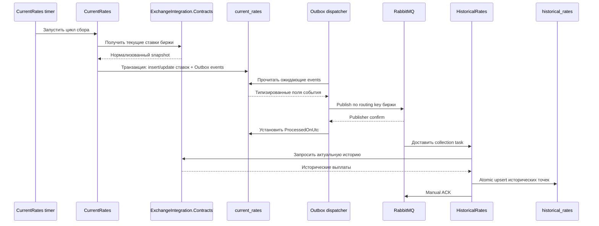
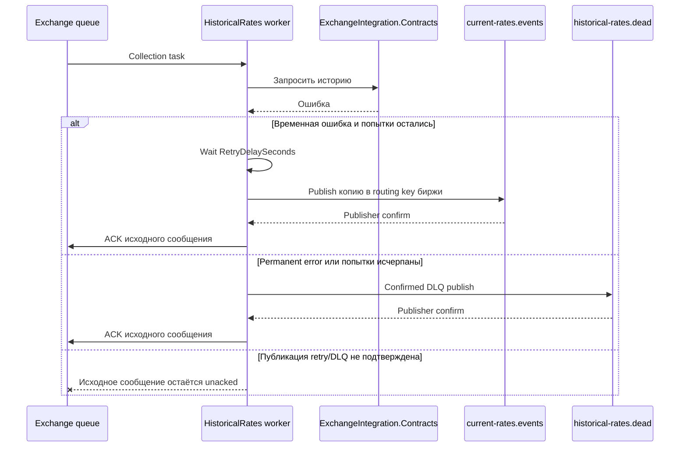
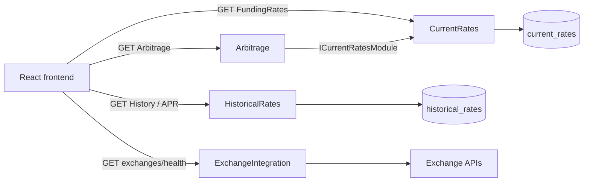
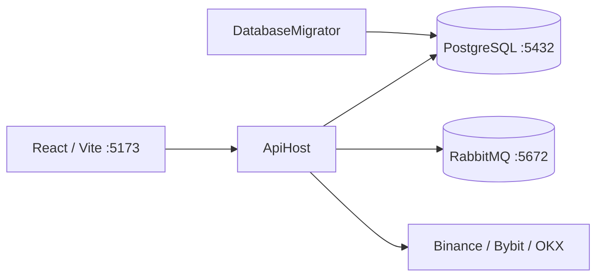

# Сквозные сценарии FundingMonitor

Здесь собраны только потоки, затрагивающие несколько модулей или внешних компонентов. Внутренние сценарии находятся на страницах соответствующих [модулей](modules/index.md).

## Сбор текущих ставок и запуск исторического сбора

Outbox закрывает окно потери между PostgreSQL commit и RabbitMQ publish. Единственный тип события хранится в колонках `Id`, `OccurredOnUtc`, `Exchange`, `Symbol` и `NextFundingTime`; JSON payload отсутствует. Сбой после publisher confirm, но до установки `ProcessedOnUtc`, может привести к повторной публикации. Inbox отсутствует: повторная доставка снова вызывает API биржи, а уникальность хранения защищает upsert по `(Exchange, NormalizedSymbol, FundingTime)`.

## Ошибка исторического сбора

Биржи имеют независимые очереди и worker pools с `prefetch=1`. Ошибка одной интеграции не занимает workers остальных бирж.

## Чтение данных пользователем

APR, spread и freshness рассчитывает backend. Frontend получает готовые business values и отвечает за отображение, фильтрацию и сортировку.

## Локальный runtime

Сначала применяется `DatabaseMigrator`, затем запускается один экземпляр `ApiHost`. `/health` проверяет зарегистрированные health checks, но HTTP endpoints и число RabbitMQ consumers проверяются отдельно.
